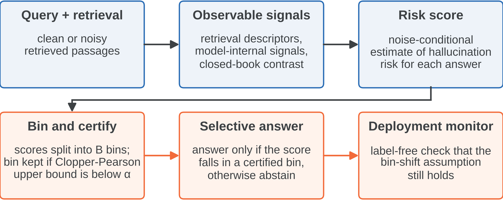
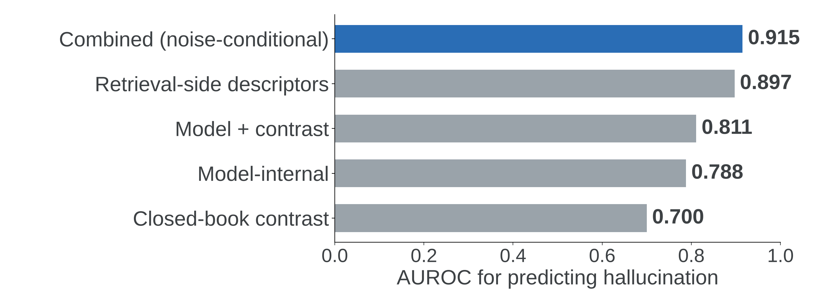
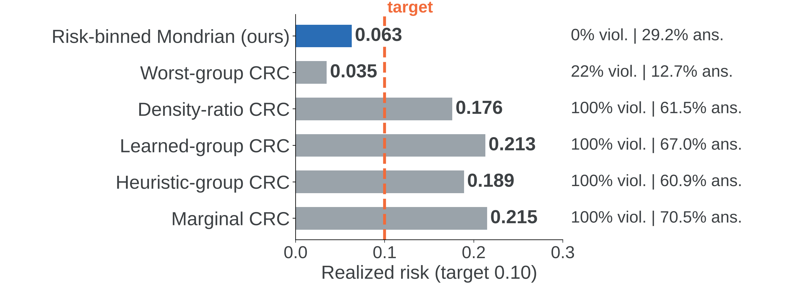

# Knowing When Not to Answer

**Noise-conditional hallucination risk estimation and shift-robust selective generation for retrieval-augmented language models.**

[](https://github.com/shoumyac/ACML-RAG/actions/workflows/ci.yml)


Accepted to the **ACML 2026 journal track** (*Machine Learning*, Springer).
Anmita Das, Shoumya Chowdhury, Sushanta Paul.

---

## The problem

A retrieval-augmented system should answer only when its risk of hallucinating is under control. But retrieval is itself a source of noise (irrelevant, contradictory or misleading passages), and the noise you see when you calibrate is not the noise you meet in deployment. Standard conformal risk control assumes the two match, so its guarantee **silently breaks** exactly when it matters.

## What this repository contributes

1. **A noise-conditional risk estimator.** Observable retrieval descriptors, model-internal signals and a closed-book contrast are combined into one hallucination-risk score. It predicts hallucination far better than model-internal uncertainty alone.
2. **Risk-binned Mondrian conformal risk control.** Calibration scores are split into bins and each bin is certified with a Clopper-Pearson upper bound. The system answers only inside certified bins. The guarantee holds under any deployment shift that reweights bins (bin-measurable shift), and a label-free monitor checks the one assumption that can fail.
3. **A controlled testbed and a full reproduction package.** A two-regime synthetic and real fact world with typed noise, a naturalistic SQuAD validation, nine generators from 80M to 14B parameters, and every result file.

<p align="center"></p>

## Headline result

Target risk 0.10, calibrate on clean-heavy data, deploy on noise-heavy data (flan-t5-base, 200 resplits).

| Method | Realized risk | Violation rate | Answer rate |
|---|---:|---:|---:|
| Marginal CRC | 0.215 | 100% | 70.5% |
| Density-ratio weighted CRC | 0.176 | 100% | 61.5% |
| Worst-group CRC | 0.035 | 22% | 12.7% |
| **Risk-binned Mondrian CRC (ours)** | **0.063** | **0%** | **29.2%** |

Standard methods and their covariate-shift remedies miss the 10% target in every resplit. Risk-binned certification never does, and it answers 2.3 times more queries than the worst-group bound that is the only other method close to valid.

<p align="center">


</p>

Other findings (full tables in [`docs/RESULTS.md`](docs/RESULTS.md)):

- The combined estimator reaches AUROC 0.915 against 0.788 for model-internal signals (+0.127, 95% CI 0.115 to 0.140), and beats sampling-based semantic entropy by 0.31 to 0.40 AUROC across seven instruction-tuned generators.
- Discrimination transfers across generators (AUROC 0.61 to 0.92) but calibration does not (1.4 to 3.2 times the target risk), so calibrate locally.
- Three regularities of noisy RAG: one unopposed false document is absorbed 85 to 100% of the time; a contradiction at the first context position is more than twice as damaging as at the last; under conflicting evidence, 100% of errors are confident assertions.

## Quickstart

```bash
git clone https://github.com/shoumyac/ACML-RAG.git
cd ACML-RAG
pip install -e ".[dev]"
python examples/reproduce_headline.py     # about 15 seconds on a laptop
pytest                                    # unit tests plus the headline integration test
```

Use the method on your own scores:

```python
import numpy as np
from ncsrag import RiskBinnedCRC

# scores: estimated hallucination risk in [0, 1] (lower is safer)
# labels: 1 = hallucination, 0 = correct answer, on a held-out calibration set
crc = RiskBinnedCRC(alpha=0.10, n_bins=10).fit(cal_scores, cal_labels)
print(crc.summary())                       # per-bin counts, Clopper-Pearson bounds, certified or not

answer = crc.answer_mask(new_scores)       # True = answer, False = abstain
risk, answer_rate = crc.evaluate(test_scores, test_labels)
```

With probability at least `1 - n_bins * delta` over the calibration draw, the hallucination rate among answered queries is at most `alpha` for every deployment distribution that only reweights score bins.

## Repository map

```
src/ncsrag/           Reusable library (the method)
  conformal.py          RiskBinnedCRC, marginal CRC, Clopper-Pearson bound, deployment monitor
  estimator.py          Noise-conditional risk estimator (grouped cross-validation)
  protocol.py           The paper's noise-shift evaluation protocol
tests/                Unit tests and an integration test on the shipped data
examples/             reproduce_headline.py
docs/                 METHOD.md, RESULTS.md, REPRODUCING.md, DATA_CARD.md
assets/               Figures used in this README
code/                 Frozen experiment and analysis scripts exactly as used for the paper
  colab/                Notebooks for the large-model, naturalistic and judge runs
data/                 Every generation and report file behind the paper's tables
  controlled/           Typed-noise grid, 9 generators from 80M to 14B parameters
  naturalistic/         SQuAD with real BM25 and dense retrieval, natural-noise runs
  judged/               LLM-judge relabeled files and the human annotation sheet
  reports/              Per-model JSON reports (AUROC, semantic-entropy gap, conformal)
```

`src/ncsrag` is the clean, tested implementation to build on. `code/` is the research record: it regenerates the paper's tables and figures and is left unchanged so results stay traceable. See [`docs/REPRODUCING.md`](docs/REPRODUCING.md).

## Limitations

Exact-match labels undercount paraphrase hallucination; one poisoning recipe is tested and no adaptive attacker; the method is blind to independently worded, mutually corroborating false passages; generators go up to 14B parameters. The guarantee needs bin-measurable shift, and the deployment monitor is the check for the within-bin case.

## Citation

```bibtex
@article{das2026knowing,
  title   = {Knowing When Not to Answer: Noise-Conditional Hallucination Risk Estimation
             and Shift-Robust Selective Generation for Retrieval-Augmented Language Models},
  author  = {Das, Anmita and Chowdhury, Shoumya and Paul, Sushanta},
  journal = {Machine Learning (Springer), ACML 2026 Journal Track},
  year    = {2026},
  note    = {Code and data: \url{https://github.com/shoumyac/ACML-RAG}}
}
```

GitHub also reads [`CITATION.cff`](CITATION.cff) for the "Cite this repository" button.

## License

MIT for the code (see [`LICENSE`](LICENSE)). The data are generations from openly licensed models plus the public SQuAD dataset.
